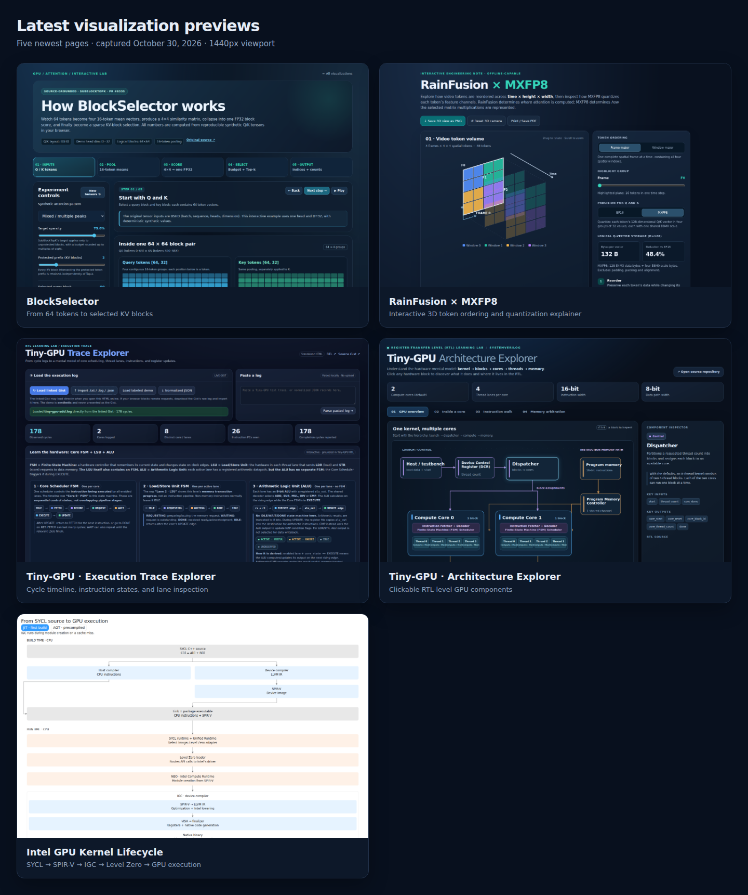

## Hi there 👋

## Interactive Visualizations

I have a growing collection of **40+ interactive visualization pages generated by an AI coding agent**, covering GPU architecture, attention and KV-cache optimization, quantization, and kernel performance.

**[Explore the visualizations →](https://yiliu30.github.io/viz/)**

<!-- 
**yiliu30/yiliu30** is a ✨ _special_ ✨ repository because its `README.md` (this file) appears on your GitHub profile.

Here are some ideas to get you started:

- 🔭 I’m currently working on ...
- 🌱 I’m currently learning ...  
- 👯 I’m looking to collaborate on ...
- 🤔 I’m looking for help with ...
- 💬 Ask me about ...
- 📫 How to reach me: ...
- 😄 Pronouns: ...
- ⚡ Fun fact: ...
-->
