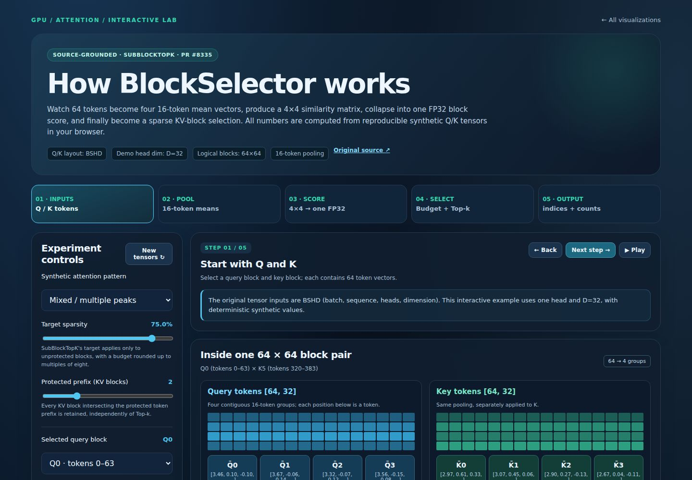
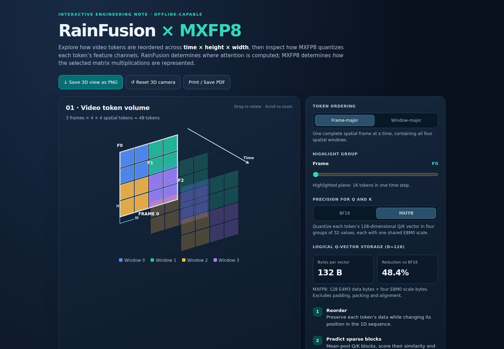
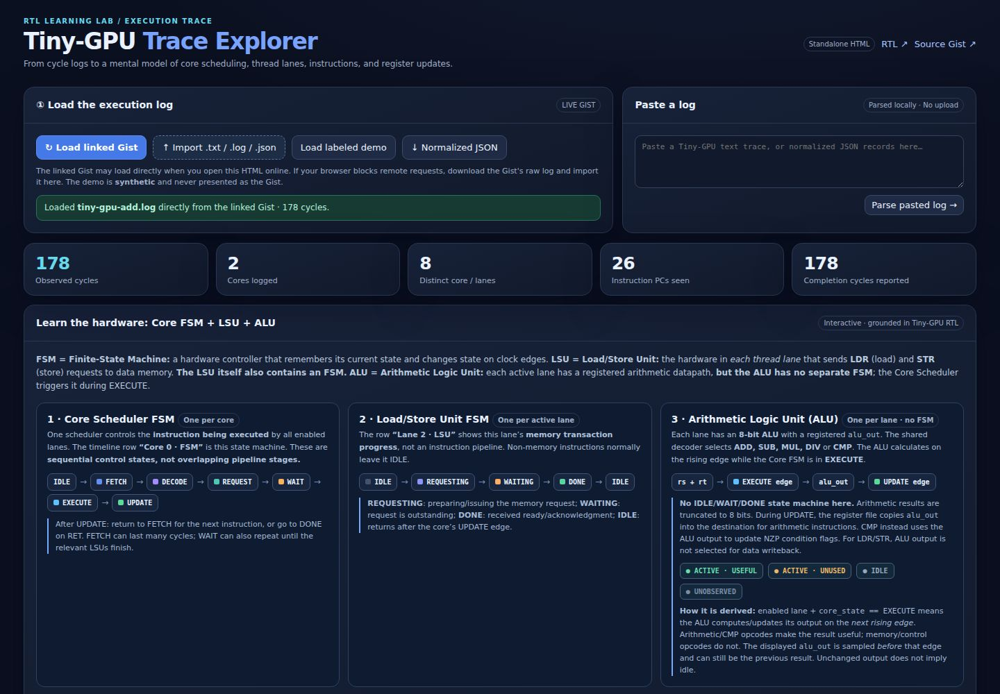

# Hi, I'm Yi Liu 👋

**Making AI inference faster, more accurate, and easier to understand.**

I'm an AI engineer at Intel focused on **low-bit quantization, efficient attention, and GPU kernel optimization**.

I maintain [AutoRound](https://github.com/intel/auto-round) and [LLM-Compressor](https://github.com/vllm-project/llm-compressor), contribute to open-source inference frameworks, and create interactive visualizations to explain how these systems work.

## 🔧 Open-source work

| Project | My focus |
|---|---|
| [AutoRound](https://github.com/intel/auto-round) | Maintainer; quantization algorithms and efficient low-bit inference |
| [LLM-Compressor](https://github.com/vllm-project/llm-compressor) | Maintainer; quantization workflows, Intel GPU support, CI/CD and community contributions |
| [vLLM](https://github.com/vllm-project/vllm) | LLM inference optimization, quantization, and GPU backend integration |
| [vLLM-Omni](https://github.com/vllm-project/vllm-omni) | Multimodal quantization, attention optimization, and model integration |
| [compressed-tensors](https://github.com/vllm-project/compressed-tensors) | Low-bit quantization formats and backend integration |

## 🔬 What I'm exploring

- **Low-bit inference:** INT4, FP8, MXFP4/MXFP8, NVFP4, and accuracy-performance tradeoffs.
- **Efficient attention:** SageAttention, block-sparse attention, and attention quantization error.
- **GPU kernels:** Performance profiling, compiler behavior, and low-level optimization.
- **Multimodal inference:** Image and video generation with efficient memory and compute.
- **AI for systems:** Agents for GPU kernel development and performance optimization.

## 🎨 Interactive AI Inference Visualizations

I build interactive explanations of GPU architecture, quantization, attention mechanisms, and inference optimization.

**[Explore 40+ interactive visualizations →](https://yiliu30.github.io/viz/)**

  
  
  

## 📄 Research

- [Optimize Weight Rounding via Signed Gradient Descent for the Quantization of LLMs](https://aclanthology.org/2024.findings-emnlp.662/) — Findings of EMNLP 2024.
- [PrefixQuant: Eliminating Outliers by Prefixed Tokens for Large Language Models Quantization](https://ieeexplore.ieee.org/document/11602642) — TPAMI.

## 🤝 Let's connect

I'm interested in practical ideas that make AI inference more efficient.

If you're working on quantization, attention algorithms, GPU kernels, or inference frameworks, I'd be happy to exchange ideas and collaborate through open source.

---

