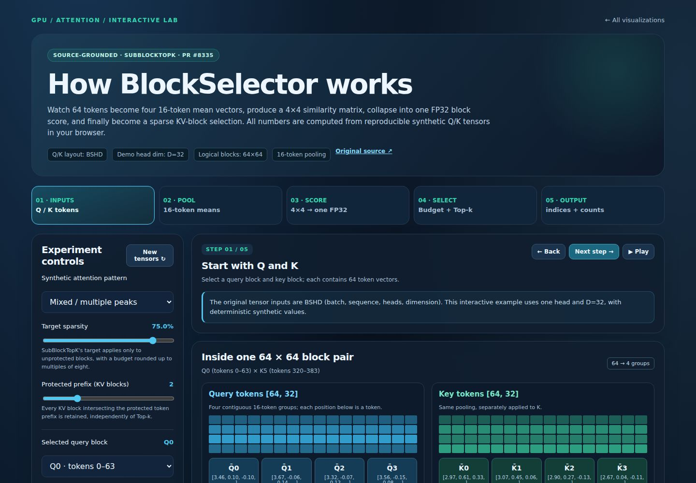
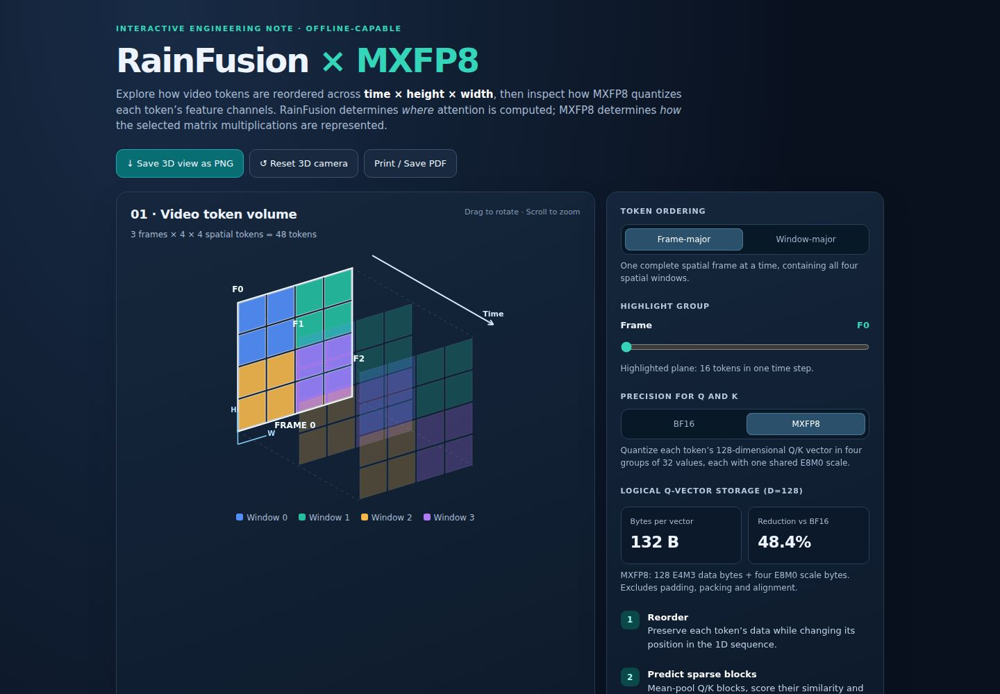
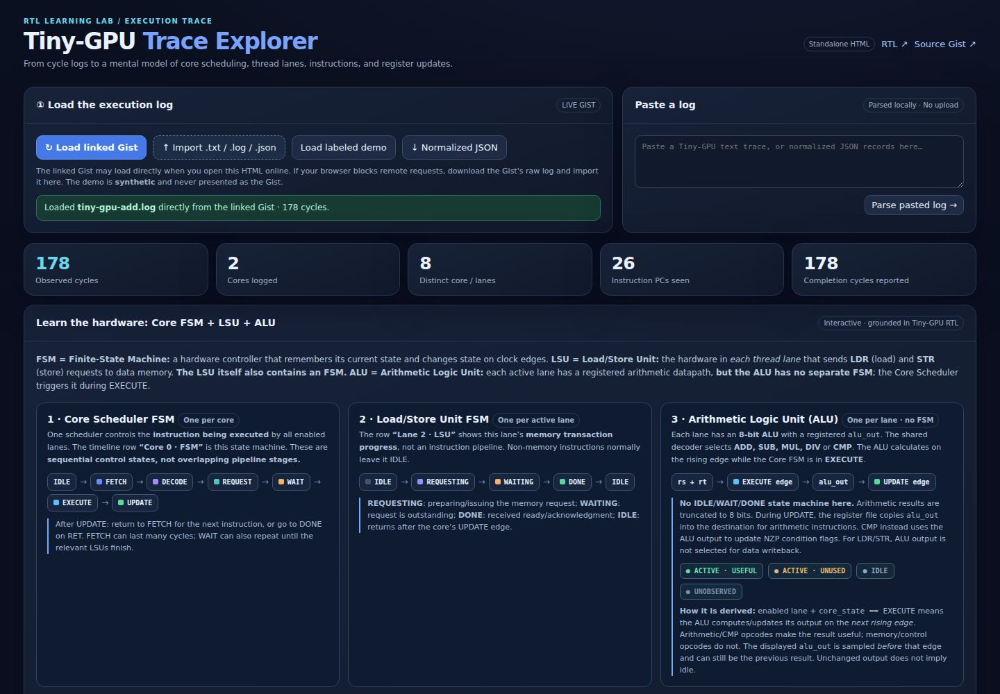

## Hi there 👋

## Interactive Visualizations

I have a growing collection of **40+ interactive visualization pages generated by an AI coding agent**, covering GPU architecture, attention and KV-cache optimization, quantization, and kernel performance.

**[Explore the visualizations →](https://yiliu30.github.io/viz/)**

  <a href="https://yiliu30.github.io/viz/blockselector_subblock_topk_interactive.html"><picture><source media="(prefers-color-scheme: dark)" srcset="assets/viz-previews/blockselector-dark.jpg"><source media="(prefers-color-scheme: light)" srcset="assets/viz-previews/blockselector-light.jpg"></picture></a>
  <a href="https://yiliu30.github.io/viz/rainfusion_mxfp8_interactive.html"><picture><source media="(prefers-color-scheme: dark)" srcset="assets/viz-previews/rainfusion-dark.jpg"><source media="(prefers-color-scheme: light)" srcset="assets/viz-previews/rainfusion-light.jpg"></picture></a>
  <a href="https://yiliu30.github.io/viz/tiny_gpu_trace_explorer%20%282%29.html"><picture><source media="(prefers-color-scheme: dark)" srcset="assets/viz-previews/tiny-gpu-trace-dark.jpg"><source media="(prefers-color-scheme: light)" srcset="assets/viz-previews/tiny-gpu-trace-light.jpg"></picture></a>

<!-- 
**yiliu30/yiliu30** is a ✨ _special_ ✨ repository because its `README.md` (this file) appears on your GitHub profile.

Here are some ideas to get you started:

- 🔭 I’m currently working on ...
- 🌱 I’m currently learning ...  
- 👯 I’m looking to collaborate on ...
- 🤔 I’m looking for help with ...
- 💬 Ask me about ...
- 📫 How to reach me: ...
- 😄 Pronouns: ...
- ⚡ Fun fact: ...
-->
